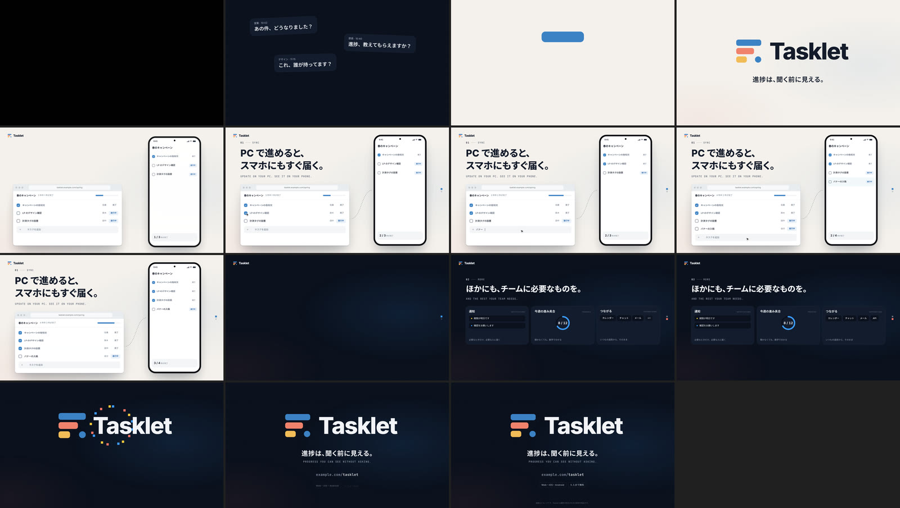

# asitaka-skills

Claude Code で使うスキル集です。

| スキル | できること |
|---|---|
| [product-video](skills/product-video/SKILL.md) | 製品・アプリ・機能の紹介動画を、コードだけで作る。画面を HTML で作り直し、1 フレームずつ撮影して MP4 にする。曲と効果音も合成する |

## product-video

「このリポジトリの紹介動画を作って」と頼むと、資料を読んで構成を決め、製品の画面を作り直し、動きと音を付けて、1920×1080・60fps の MP4 を書き出します。動画編集ソフトも、素材ファイルも要りません。



雛形に入っている見本動画（架空の製品の 30 秒）を、2 秒おきに並べたものです。

### 必要なもの

- Claude Code
- Node.js 20 以上
- ffmpeg（`brew install ffmpeg` / `apt install ffmpeg` / `winget install ffmpeg`）
- Chromium。次のどちらか
  - `npx playwright install chromium`（動画のプロジェクトで `npm install` した後に実行）
  - すでに入っている Chrome か Edge を使う（環境変数 `CHROME_CHANNEL=chrome` か `CHROME_CHANNEL=msedge` を付けて実行）

Remotion と GSAP は使っていません。依存しているのは Playwright（Apache-2.0）と、フォント 3 種（Inter・Noto Sans JP・JetBrains Mono。いずれも SIL Open Font License）だけです。曲と効果音はコードで合成するので、音の素材もありません。ffmpeg は各自で入れたものを呼び出します（配布物には含めていません）。

### 入れ方

どれか 1 つで使えます。

**A. プラグインとして入れる**（更新を受け取りやすい）

```sh
claude plugin marketplace add phni3j9a/asitaka-skills
claude plugin install asitaka-skills@asitaka-skills
```

**B. フォルダを置く**（自分の全プロジェクトで使う）

```sh
git clone https://github.com/phni3j9a/asitaka-skills
cp -R asitaka-skills/skills/product-video ~/.claude/skills/
```

**C. リポジトリに入れる**（そのリポジトリで作業する全員が使う）

`skills/product-video` フォルダを、対象のリポジトリの `.claude/skills/product-video` に複製してコミットします。

### 頼み方

```
このリポジトリの紹介動画を作ってください。60 秒くらいで、〇〇をしている人向けです。
```

- 資料は多いほど正確になります。README、デザインの決まり（色・フォント・ロゴ）、画面の文言、スクリーンショットがあると、画面の再現が実物に近づきます
- 尺・言語・見せたい機能・避けたい表現があれば、最初に伝えます。なければ Claude が決めて、報告に書きます
- 直したいときは「18 秒あたりの見出しを〇〇に」「タイルを 1 枚足して」のように、場面や時刻で頼みます
- 30 秒の動画で 1 時間前後、90 秒で数時間かかります（画面の作り込みと確認に時間を使います）

### できあがるもの

動画のプロジェクト（既定では `video/`）の `out/` に書き出されます。

| ファイル | 内容 |
|---|---|
| `video.mp4` | 完成版（1920×1080・60fps・H.264・音声つき） |
| `video-web.mp4` | 10 MB 未満の軽量版（1280×720・30fps）。チャットや GitHub に貼れる |
| `poster.png` | 見出し用の静止画 |

`out/` は Git の管理外です。残したい動画は別の場所へ複製してください。

### 知っておいてほしいこと

- **音は、人が聴いて確かめてください。** Claude は音を聴けません。音量などは数値で検査していますが、曲の好みや効果音の量は、聴いて判断する必要があります
- **画面は作り直しです。** スクリーンショットではなく、HTML で再現したものです。最後のカードに、その断り書きが入ります
- **事実の確認は人の仕事です。** 資料にないことは入れないよう指示していますが、公開する前に、機能・数値・表記を確かめてください

## リポジトリの構成

```
.claude-plugin/        プラグインとして入れるための定義
skills/product-video/  スキル本体
  SKILL.md             手順と決まり
  references/          演出・部品の使い方・音・検品
  scripts/new.mjs      雛形を複製する
  assets/template/     動画のプロジェクトの雛形（見本動画、撮影と検品の道具）
evals/product-video/   スキルを試すためのケース（新規に作る／既存を直す）
```

## スキルを直したとき

```sh
claude plugin validate .                     # 定義の検査
node skills/product-video/scripts/new.mjs /tmp/pv-test && cd /tmp/pv-test \
  && npm install --ignore-scripts && node render.mjs --lint && node render.mjs && node tools/qa.mjs
```

`evals/product-video/` には、スキルを試すためのケースが 2 つあります（`claude plugin eval` の形式）。

| ケース | 内容 | 目安 |
|---|---|---|
| `edit-existing-video` | 見本動画を 3 か所直す | 5〜10 分 |
| `intro-video-from-repo` | 架空の製品の資料から、30〜40 秒の紹介動画を新規に作る | 1 時間以上。利用量も多い |

```sh
claude plugin eval . --case edit-existing-video --ablation none --scaffold --allow-tools Bash Write Edit
```

`--ablation none` を外すと「スキルなし」の比較用の実行が増え、`--case` を外すと動画を新規に作るケースも走ります。

> このコマンドでの実行は、まだ確かめていません（作成時は、同じ 2 つの依頼を別の方法で試しました）。最初に動かすときは、オプションの過不足がないか `claude plugin eval --help` と見比べてください。
